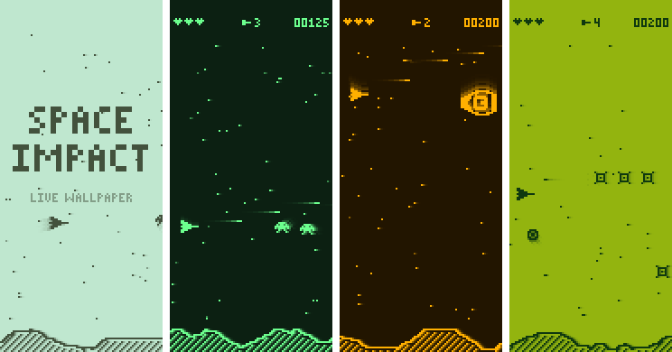

# Live-wallpapers
Live wallpapers for Android mobile

## Space Impact

A self-playing tribute to the classic Nokia shooter, rendered on a fake monochrome LCD.



- An autopilot ship flies, dodges, shoots alien waves and fights a boss at the end of every level.
- Five enemy types, a scrolling landscape, parallax stars, pickups that add missiles, and the
  HUD with lives, missiles and a five-digit score.
- Chunky square pixels with LCD cell gaps and the slight ghosting of an old phone screen.
- Four color schemes: Classic green, Night (dark, good for OLED), Amber and Pocket console.
- Tap an empty spot on the home screen to steer the ship there and launch a missile.
- Only animates while the wallpaper is visible, at 30 fps.

### Install

Download the `space-impact-debug-apk` artifact from the latest
[Android build](../../actions/workflows/android.yml) run, or build it yourself:

```sh
./gradlew :space-impact:assembleDebug
adb install space-impact/build/outputs/apk/debug/space-impact-debug.apk
```

Open **Space Impact LWP** from the app drawer, choose colors, and tap **Set live wallpaper**.

### Code layout

- `space-impact/src/main/java/.../game/` is the game: simulation, autopilot, sprites and
  font, rendering into a low resolution brightness buffer. It is plain Java, so
  `./gradlew :space-impact:testDebugUnitTest` runs it on the JVM.
- `LcdRenderer` scales that buffer onto the screen; `SpaceImpactWallpaperService` drives it;
  `SettingsActivity` is the launcher and settings screen.
