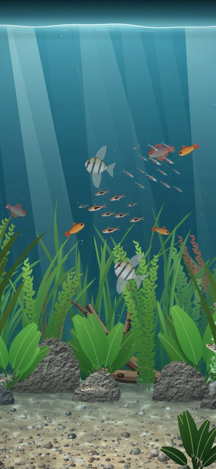
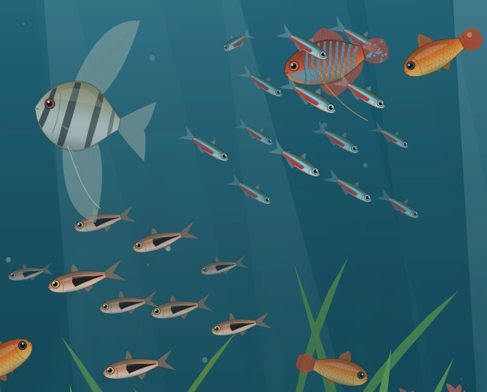

# Live-wallpapers

Live wallpapers for Android mobile.

## Aquarium

A realistic planted freshwater aquarium. Everything is generated procedurally in code: there are no
image assets apart from the launcher icon and the picker thumbnail.

<p>
  
  
</p>

### What's in the tank

- **Six fish species**, each with its own anatomy, markings and behaviour:
  - schools of blue-and-red tetras and copper rasboras, which flock with boids-style steering
  - angelfish with tall sweeping fins and trailing feelers
  - dwarf gouramis with slanted turquoise bars
  - sunset platies
  - corydoras catfish that forage along the sand, pause, and now and then dart up for a gulp of air
- **Side-view swimming**. Because you see the fish from the side, the tail beat shows as the fin
  foreshortening while it sweeps towards and away from you. Fins flutter, the fish pitch up and down
  as they climb and dive, and they turn by rotating to face you before swimming off the other way.
- **Plants**: eelgrass whose ribbon leaves twist and sway in the current, stem plants with leaf pairs
  set at alternating angles, and broad-leaved sword plants. Some foreground plants sit in front of the fish.
- **Hardscape**: craggy stones shaded pixel by pixel from a noise height field, a gnarled piece of
  driftwood, and a gravel bed with scattered pebbles.
- **Light and water**: a looping animated caustics pattern on the sand, light shafts that slowly brighten
  and fade, a rippling water line seen from below, a blurred hazy background for depth, drifting
  particles and a vignette.
- **Bubbles**: a bubble curtain from an air stone, with large bubbles that wobble and flatten as they rise,
  plus occasional oxygen bubbles from the plants.
- **Tap to feed**: tap an empty part of the home screen and food flakes land on the surface, then sink.
  Nearby fish rush over to eat them, and the catfish clean up what reaches the bottom.
- **Parallax**: the tank is wider than the screen. Swiping between home screens pans across it, and
  the distant layers move more slowly than the near ones.

### Settings

Open them from the wallpaper picker:

| Setting | Options |
| --- | --- |
| Number of fish | Few / Normal / Many |
| Tap to feed | on / off |
| Air stone bubbles, light rays, caustics | on / off |
| Parallax scrolling | on / off |
| Frame rate | 30 fps (battery saver) / 60 fps |

The wallpaper only renders while it is visible. It uses a dedicated render thread paced by
`Choreographer`, and a hardware-accelerated canvas on Android 8.0 and later.

### Building

Requirements: the Android SDK (compileSdk 34) and JDK 17.

```sh
./gradlew assembleDebug
adb install app/build/outputs/apk/debug/app-debug.apk
```

Or open the project in Android Studio. Every push also runs the **Build APK** GitHub Actions workflow,
which uploads the debug APK as a build artifact.

After installing, open **Aquarium Live Wallpaper** from the app drawer. It takes you straight to the
system preview, where you tap *Set wallpaper*. You can also find it under your launcher's
wallpaper settings → Live wallpapers → **Aquarium**.

Minimum Android version: 7.0 (API 24).

### Code layout

```
app/src/main/java/com/livewallpapers/aquarium/
├── AquariumWallpaperService.java   WallpaperService + render thread, offsets, taps, prefs
├── SettingsActivity.java           Preference screen
├── SetWallpaperActivity.java       Launcher shortcut to the live wallpaper preview
└── scene/                          Pure android.graphics scene, no framework dependencies
    ├── AquariumScene.java          Layer ordering, camera/parallax, world geometry
    ├── Background.java             Low-res blurred far background
    ├── WaterSurface.java, LightRays.java, Sand.java (substrate + caustics)
    ├── Vallisneria.java, StemPlant.java, SwordPlant.java
    ├── Rock.java, Driftwood.java, AirStone.java
    ├── Fish.java, Species.java     Fish anatomy, rendering and steering
    └── Bubbles.java, Particles.java, Food.java
```
